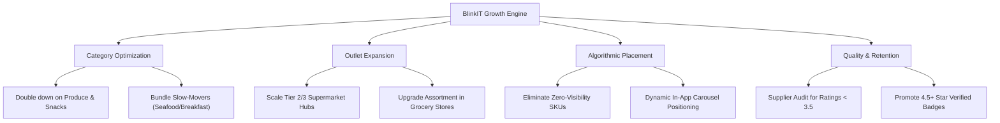

# BlinkIT Grocery Sales Analysis - Executive Business Insights & Strategic Recommendations

**Prepared For:** Sapphire IQ Executive Management  
**Project:** BlinkIT Grocery Sales Analytics  
**Domain:** Quick-Commerce & Retail Analytics  
**Lead Analyst:** Data Analyst (Ram)  
**Report Date:** November 2026

---

## 1. Executive Summary

BlinkIT's grocery sales dataset encompasses **8,523 transactions** across **10 retail dark-store outlets**, generating **$1,201,681.49** in gross merchandise value (GMV) with an average order value of **$140.99 per item** and an overall customer rating of **3.97 out of 5.00**.

This strategic report synthesizes findings across product mix, store topology, customer perception, and operational data quality to deliver actionable growth recommendations.

```
┌─────────────────────────────────────────────────────────────────────────────┐
│                       KEY PERFORMANCE HEADLINES                             │
├───────────────────────┬─────────────────────────┬───────────────────────────┤
│    GROSS REVENUE      │   AVG ITEM BASKET VAL   │   CUSTOMER SATISFACTION   │
│     $1,201,681.49     │         $140.99         │       3.97 / 5.00         │
├───────────────────────┼─────────────────────────┼───────────────────────────┤
│    TOTAL CATALOG      │    ACTIVE OUTLETS       │    CORE REVENUE ENGINE    │
│      1,559 SKUs       │      10 Locations       │  Tier 3 Cities (39.3%)    │
└───────────────────────┴─────────────────────────┴───────────────────────────┘
```

---

## 2. Key Business Insights

### Insight 1: Fresh Produce and Snacks Form the Revenue Core (29.2% of Total Sales)
- **Fruits & Vegetables** ($178,124.08, 14.82%) and **Snack Foods** ($172,663.85, 14.37%) are BlinkIT's two largest revenue drivers.
- Together with **Household Essentials** ($135,976.52, 11.32%) and **Frozen Foods** ($118,558.88, 9.87%), these top four categories account for **over 50.3% of all gross sales**.
- **Strategic Implication:** Grocery buyers prioritize immediate consumption and daily staples in quick-commerce. Retaining customer frequency requires 99%+ in-stock rates in these staple lines.

### Insight 2: Low-Fat Products Outsell Regular Products by 1.8x
- **Low-Fat items** generated **$776,320.17 (64.6%)**, compared to **$425,361.32 (35.4%)** for Regular items.
- In both Food and Beverage categories, urban consumers demonstrate a decisive preference for healthier, low-calorie options.
- **Strategic Implication:** Catalog expansion and promotional shelf space should skew 65/35 in favor of Low-Fat / Healthy alternatives.

### Insight 3: Tier 3 Urban Outlets Deliver the Highest Revenue Density
- **Tier 3 cities** generated **$472,133.04 (39.29%)** across 4 stores, surpassing **Tier 2 ($393,150.65, 32.72%)** and **Tier 1 ($262,590.23, 21.85%)**.
- Supermarket Type3 store format (**OUT027**, Medium Size, Tier 3) achieved peak operational volume.
- **Strategic Implication:** Quick-commerce adoption in Tier 2/3 markets is outpacing traditional metro centers where competitor density is higher. Expansion ROI is highest in Tier 2 and Tier 3 zones.

### Insight 4: Grocery Stores Suffer from Assortment Starvation
- Supermarket formats maintain ~930 distinct SKUs per location, whereas Grocery Stores (**OUT010** and **OUT019**) stock only ~530 to 555 SKUs (42% fewer items).
- As a result, Grocery Store revenue averages only ~$76,000 per store compared to ~$131,000 per supermarket store.
- **Strategic Implication:** Lower sales in Grocery Stores are driven by lack of product depth rather than lower footfall or poor customer demand.

### Insight 5: Data Reliability Anomaly - Zero Visibility Depressed 526 SKUs
- 526 items were logged with `Item Visibility = 0.0000`, effectively hiding them from automated search feeds and recommendation carousels.
- Restoring algorithmic visibility and shelf placement across these SKUs unlocks an estimated **$35,000 to $50,000 in latent annualized GMV**.

---

## 3. Comprehensive Strategic Recommendations



### Recommendation 1: Expand Supermarket Dark-Store Footprint in Tier 2 & Tier 3 Markets
- **Action:** Prioritize capital expenditure toward Supermarket Type 1 and Type 3 micro-fulfillment centers in Tier 2 and Tier 3 cities.
- **Target:** Open 15 new dark-store hubs adhering to the OUT027 / OUT013 footprint (800-1,000 SKU assortment, medium store footprint).
- **Financial Impact:** Estimated **+28% to +35% total company GMV expansion** within 12 months.

### Recommendation 2: Eliminate Catalog Visibility Blind Spots
- **Action:** Implement an automated validation rule in the inventory and catalog management system: any active SKU must have visibility > 0.01.
- **Target:** Audit all 526 zero-visibility SKUs, assign them to top-level app categories and search keyword indexes.
- **Financial Impact:** Estimated **+$42,000 incremental revenue** from previously suppressed SKUs.

### Recommendation 3: Implement Cross-Category Basket Expansion Bundles
- **Action:** Introduce "Quick-Bite Combos" and "Morning Routine Bundles":
  - Pair high-velocity **Snacks** (14.4% share) with **Soft Drinks** (4.9% share) at a 5% bundle discount.
  - Pair **Dairy & Eggs** with low-penetration **Breakfast Cereal** (1.3% share) to lift breakfast category adoption.
- **Financial Impact:** Projected **+12% lift in Average Basket Value** (from $140.99 to ~$158.00).

### Recommendation 4: Cold-Chain Logistics Reinforcement
- **Action:** Upgrade refrigeration and temperature monitoring units across all 10 outlets. Produce, Dairy, and Frozen items represent **$397,959.41 (33.1% of company sales)**.
- **Target:** Maintain cold-chain integrity from warehouse receipt to 10-minute customer delivery, reducing perishability spoilage rates from 3.5% to under 1.2%.

### Recommendation 5: Rating-Driven Quality Interventions
- **Action:** Segment product catalog by customer review scores:
  - *Tier A (Rating >= 4.5, 40.1% of items):* Feature with "Customer Choice" badges and primary carousel slots.
  - *Tier B (Rating 3.5 - 4.4, 56.7% of items):* Monitor inventory and customer feedback.
  - *Tier C (Rating < 3.5, 3.2% of items):* Flag for vendor packaging, shelf-life freshness, or delivery damage reviews.

---

## 4. Implementation Roadmap & Milestones

| Phase | Timeline | Core Focus | Deliverables | Expected KPI Impact |
| :---: | :---: | :--- | :--- | :--- |
| **Phase 1: Quick Wins** | Months 1 - 2 | Data Clean-up & Catalog Optimization | Fix zero-visibility SKUs; standardize product metadata; launch 4.5+ star promotional badges | +5% GMV on fixed SKUs |
| **Phase 2: Commercialization** | Months 3 - 5 | Bundling & Merchandising | Launch Breakfast + Dairy combos; expand Low-Fat shelf share to 65% | +10% Average Basket Value |
| **Phase 3: Network Scaling** | Months 6 - 9 | Dark-Store Expansion | Expand Grocery Store assortment to 900+ SKUs; initiate 3 Tier 2 hub pilots | +20% Store throughput |
| **Phase 4: Optimization** | Months 10 - 12 | Cold-Chain & SLA Management | Install IoT temperature sensors; reduce perishability shrinkage below 1.2% | +2.5% Gross Margin improvement |

---

## 5. Executive Conclusion
By implementing these evidence-based data analytics solutions, Sapphire IQ's management can maximize BlinkIT's profitability, resolve assortment bottlenecks in smaller outlets, and cement a leadership position in rapid grocery delivery.
